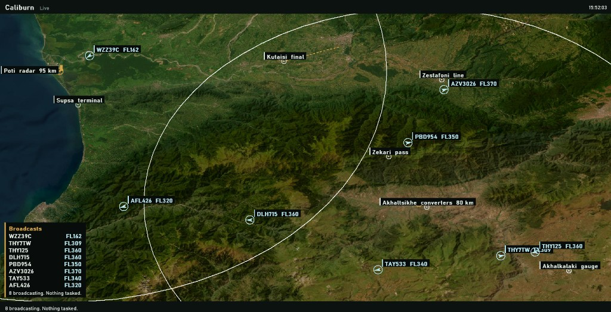

# Caliburn

Made for the Georgian government. It watches the east-west spine: Poti and Supsa on the sea, Kutaisi, the line through Zestafoni, the two 350 MW converters at Akhaltsikhe, the gauge change at Akhalkalaki, and the Zekari pass that sits between the coast and the yard.



The coast radar at Poti does not see the converter yard. Zekari is in the way. The second radar stands at Akhaltsikhe so that yard is not a hole in the picture.

The window is the live scope. The ground is satellite imagery of the corridor, the clock is Georgia local time, and the aircraft are the ones actually broadcasting overhead. Each mark carries a callsign and a flight level. They are civil, so nothing is tasked against them. A broadcast on the Kutaisi instrument final is marked withheld. The low air here is Class G up to FL85 or 2,000 ft above the ground, whichever is higher, and that final is the hard line.

The battery is for a track that is closing on the spine, and only then. The aircraft flies to a point 2,500 m short of the track. Reaching that point, or losing the track, is the order to leave. It turns out and comes home under a parachute. Closest approach stays outside 1,500 m. There is no warhead and no impact mode. One key missing and the magazine stays on the rail. The arrival into Kutaisi, squawking, is never paired.

That is the help. The watch on the tie, the converters, and the gauge change can see who is only passing through, where the ridge hides a track from the coast, and who has to be left alone because they are on the final. The magazine does not move against civil traffic.

## Run

From `card`:

```text
go run .
```

Space asks for a fresh air picture.

```text
python -m unittest discover -s tests -v
```

checks the same engagements. Run it from this directory.

## What has to hold

- The two aircraft over the plain are still two tracks after they meet.
- The fast one going for the ridge keeps a single track id while the radars are dark, and that id is marked coasting.
- The Kutaisi arrival is not given an aircraft.
- A hostile on the final is withheld.
- The sea aircraft are told to leave, and their closest approach stays outside 1,500 m.
- If the plots stop, the aircraft leaves anyway, still outside 1,500 m.
- Running the same seed again writes the same pairs.

## Layout

- `caliburn/terrain.py` ground height and line of sight
- `caliburn/tracks.py` the two radars and the hypotheses
- `caliburn/pair.py` the magazine
- `caliburn/fly.py` the aircraft, which only knows how to leave
- `caliburn/sim.py` one raid
- `card/` the battery and the live scope
